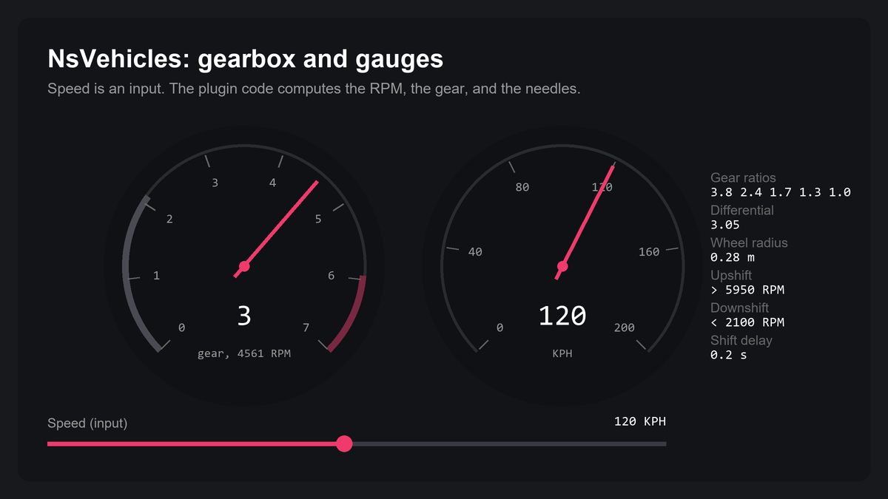

# NsVehicles User Guide

## Purpose

NsVehicles is a runtime plugin for physics vehicles: cars, karts, trucks, bikes, and hover vehicles. One physics body moves the vehicle. Suspension components trace the ground and push the body up. Module components on the vehicle add the drive, brake, steering, and other forces. You tune all of them in the Details panel, or call them from Blueprint and C++.

NsVehicles is not a full tire model, and it is not a Chaos Vehicles replacement. The wheels are traces, not colliders. The drive force acts on the body, not on each wheel. There is no clutch.

[](Showcase/Gearbox.html)

## Setup

1. Copy the `NsVehicles` folder into the `Plugins` folder of your project.
2. For C++, add `"NsVehicle"` and `"AsyncTickPhysics"` to `PublicDependencyModuleNames` in the `Build.cs` file of your game module. `ANsVehicle` derives from `AAsyncTickPawn`, which is in `AsyncTickPhysics`.
3. Generate the project files and build the project.
4. In **Edit > Plugins**, enable **NsVehicle**. Restart the editor.
5. Recommended: enable **Project Settings > Physics > Tick Physics Async**. The vehicle step then runs on the physics thread.

The plugin runs on Win64, Mac, Linux, Android, and iOS.

## Quick Start

### Blueprint

1. Make a Blueprint class with `NsVehicle` as the parent.
2. Add a Static Mesh component as the root. Give it a mesh with simple collision.
3. On the root, enable **Simulate Physics**.
4. Add four `NsVehicleSuspensionComponent` components under the root. Put each one above a wheel position.
5. On each suspension component, set **Wheel Mesh**.
6. On the two front suspension components, enable **Is Steering Wheel**.
7. In the input events, call `Get Controls`, then `Set Throttle Input`, `Set Brake Input`, and `Set Steering Input`.
8. Place the vehicle in a level, possess it, and press Play.

The vehicle gets all modules automatically. The default Engine module uses the arcade powertrain, so the vehicle drives with no other setup.

### C++

```cpp
#include "Modules/Control/NsVehicleControlsComponent.h"
#include "Vehicle/NsVehicle.h"

void AMyPlayerController::DriveForward(ANsVehicle* Vehicle, const float Input)
{
    Vehicle->GetControls()->SetThrottleInput(Input);
}
```

## Common Tasks

### Find a setting

Each system is a module component on the vehicle. Select the module in the Components panel to see its settings. In Blueprint or C++, call the module getter on the vehicle, for example `Get Engine`, `Get Brakes`, or `Get Steering`.

| Module | Getter | What it does |
|---|---|---|
| Controls | `Get Controls` | Holds the driver input and sends it to the server |
| Engine | `Get Engine` | Makes the torque and the RPM. Selects arcade or standard |
| Transmission | `Get Transmission` | Owns the gears, the differential, and the automatic gearbox |
| Drivetrain | `Get Drivetrain` | Removes power when the driven wheels slip |
| Brakes | `Get Brakes` | Owns the brakes, the reverse drive, and the handbrake |
| Steering | `Get Steering` | Limits the steering by speed and turns the steering wheels |
| BodyDynamics | `Get Body Dynamics` | Adds the body pitch and the bike lean |
| Aerodynamics | `Get Aerodynamics` | Adds the air drag in the standard powertrain |
| AirControl | `Get Air Control` | Turns the vehicle in the air |
| AntiGravity | `Get Anti Gravity` | Pulls the vehicle to the surface under it |
| IdleLock | `Get Idle Lock` | Holds the vehicle in place when it stops |
| Network | `Get Network` | Replicates the vehicle state |
| Animation | `Get Animation` | Spins the wheels for the take recorder |

### Make a wheel mesh

1. Put the origin of the wheel mesh at the wheel center.
2. Put the axle on the Y axis. The wheel spins on its pitch axis.
3. Give the mesh simple collision if you want to detach the wheel.

The suspension uses half the mesh height as the wheel radius. With no wheel mesh, it uses **Radius** (33 cm).

### Show the wheels in the editor

1. Add a Static Mesh component under each suspension component. Set the wheel mesh on it.
2. On the suspension component, enable **Inherit Mesh From Component**.

The suspension uses its first child as the wheel mesh. Keep the wheel mesh as the first child, and attach other components to the root.

### Use the standard powertrain

1. On the Engine module, set **Powertrain Type** to Standard.
2. On the Transmission module, fill **Gear Ratios** with one ratio for each gear.
3. Set **Differential Ratio** and **Wheel Radius**. **Wheel Radius** is in meters.
4. Optional: set **Torque Implementation** to Curve, and set **Engine Torque Curve**.

The automatic gearbox shifts from the RPM. To shift from the speed, enable **Use Speed Based Shifting** and fill **Speed Shifting Ratios**. To shift by hand, disable **Automatic** and call `Upshift` and `Downshift`.

### Set up the driven wheels

1. On the Engine module, set **Powertrain Type** to Standard. The slip power loss works only in the standard powertrain.
2. On the Drivetrain module, enable **Use Drivetrain**.
3. On each suspension component, enable **Use With Drivetrain**.
4. On each driven wheel, enable **Driven Wheel**.
5. On each driven wheel, set **Torque Received**. For RWD, use 0.5 on each rear wheel.

A driven wheel slips when its torque is above the traction limit. Then it loses grip and spins faster. With **Use Drivetrain** on, the vehicle is airborne when no driven wheel touches the ground. **In Air Wheel Count** then has no effect.

### Detach a wheel

1. Give the wheel mesh simple collision.
2. Call `Detach Wheel` on the suspension component, after Begin Play. **Impulse** is a velocity change in cm/s.

```cpp
FrontLeftWheel->DetachWheel(FVector(0.f, -600.f, 400.f));
```

The wheel mesh becomes a free physics body with the velocity of the vehicle at that point. The suspension stops all its forces. The vehicle ignores detached wheels when it counts airborne wheels.

### Attach a detached wheel again

1. Call `Reattach Wheel` on the same suspension component.

The wheel mesh stops its physics, turns off its collision, and goes back under the suspension component. The suspension forces start again.

```cpp
FrontLeftWheel->ReattachWheel();
```

### Set up the handbrake

1. On the Brakes module, set **Handbrake Strength**.
2. On each suspension component that the handbrake holds, enable **Handbrake Wheel**.
3. Set **Handbrake Wheel Type** to Front or Rear.
4. Call `Get Controls`, then `Apply Handbrake Input`.

The handbrake wheels stop their spin while the handbrake is on. The handbrake does not change the grip. For a drift, set **Lateral Force Scalar** lower on the rear wheels while the handbrake is on.

### Make a bike lean in turns

1. On the Body Dynamics module, enable **Use Steer Lean**.
2. In Begin Play, call `Get Body Dynamics`, then `Initialize Lean Steer` with one suspension component. A rear wheel gives the best result.
3. Tune **Steer Lean Coefficient** and **Steer Lean Min Speed**.

### Drive on walls with anti gravity

1. Add a Scene component to the vehicle.
2. On the Anti Gravity module, enable **Anti Gravity Enabled**.
3. In Begin Play, call `Get Anti Gravity`, then `Initialize Anti Gravity`. Pass the Scene component and the root static mesh.
4. Tune **Anti Gravity Z Strength** first. Values from 1 to 2 work well.

The system stays on for **Anti Gravity Off Contact Threshold** seconds after the vehicle leaves the ground. Call `Override Anti Gravity State` with true to keep it on.

### Animate the interior

1. Add one of these components under the vehicle.
2. Set its mesh.

The vehicle sets the rotation on one axis every frame. The other axes keep their values from Begin Play.

| Component | Value | Default input range | Default angle range |
|---|---|---|---|
| `NsVehicleTachometerComponent` | Engine RPM | 0 to 7000 | 0 to 270, roll |
| `NsVehicleSpeedometerComponent` | Speed in KPH | 0 to 200 | 0 to 270, roll |
| `NsVehicleSteeringWheelComponent` | Steering input | -1 to 1 | -450 to 450, roll |
| `NsVehicleThrottlePedalComponent` | Throttle input | 0 to 1 | 0 to 20, pitch |
| `NsVehicleBrakePedalComponent` | Brake input | 0 to 1 | 0 to 20, pitch |
| `NsVehicleHandbrakeLeverComponent` | Handbrake input | 0 to 1 | 0 to 30, pitch |

Each one has **Input Range**, **Output Range**, **Rotation Axis**, **Use Smoothing**, **Smoothing Speed**, and **Invert**.

### Move a part, for example a forklift arm

1. Add an **NsVehicle Articulated Component** under the vehicle.
2. Set **Axis**, **Min**, **Max**, and **Movement Speed**.
3. Call `Set Input`. A positive value moves to Max. A negative value moves to Min.

### Follow a spline with AI

1. Add an `NsVehicleAI` component to the vehicle.
2. Call `Set Target Spline` with a spline component.
3. In Event Tick, call `Update` with the frame time.
4. Send **Out Steering** to `Set Steering Input`.

Tune **Kp** first, then **Kd** and **Kd2**. Use **Ki** to remove a constant offset. Call `Refresh` when you change the spline.

### Ignore some surfaces

1. In **Project Settings > Collision**, add a trace channel with the default response Block.
2. On each suspension component, set **Collision Channel** to the new channel.
3. On the objects that the wheels must ignore, set the response for the new channel to Ignore.

### Replicate the vehicle

1. On the Network module, set **Replication Method**.
2. For Data Only, use another system to correct the client position, for example **Replicate Movement** on the actor.

| Method | Server | Clients |
|---|---|---|
| Full | Simulates and sends the state | Copy the server velocities each physics step. They do not run the powertrain |
| Data Only | Simulates and sends the state | Copy the inputs, RPM, gear, and speed, then simulate |
| None | Simulates | Simulate. Nothing replicates |

With Full, **Use Server Fast Sync** also copies the server transform to the clients every **Server Fast Sync Latency** frames.

For many replicated vehicles, disable **Auto Wake Rigid Bodies** on the vehicle. Then call `RT Wake Rigid Bodies` often, for example from the input events.

### Send custom input to the server

1. Call `Get Controls`, then `Set Ext Replication Input` with an index from 0 to 5 and a value from -1 to 1.
2. On the server, read it with `Get Ext Replication Input`, for example in `Event Async Tick`.

The value goes from the client to the server only. Other clients do not get it.

### Record with the take recorder

1. On the Animation module, enable **Enable Animation Mode**.
2. Record the vehicle with the take recorder.
3. Disable **Enable Animation Mode** after the recording.

In animation mode, the wheels spin from the actor movement, not from the physics. For playback, add `NsVehicleWheel` components to the root. Then call `Initialize Animation System` one time and `Simulate Internal Animation` every frame.

## Settings

Every value is the default in the code. Some settings show only when another setting enables them.

### Vehicle

| Setting | Default | Effect |
|---|---|---|
| In Air Wheel Count | 2 | Wheels off the ground that make the vehicle airborne. An airborne vehicle gets no drive force. No effect with **Use Drivetrain** |
| Auto Wake Rigid Bodies | true | Wakes the physics body every frame |

### Engine

| Setting | Default | Effect |
|---|---|---|
| Powertrain Type | Arcade | Arcade: torque that fades out near the top speed, no gearbox. Standard: RPM, gears, and drag |
| Engine Torque | 500 | Peak torque in Nm |
| Max Speed | 318 | Arcade top speed in KPH |
| Max RPM | 7000 | Standard maximum RPM |
| Rpm Limit Torque Floor | 0.06 | Drive force scale that stays at the RPM limit |
| RPM Multiplier | 1 | RPM scale. Other values can make the engine unstable |
| Torque Implementation | Constant | Constant torque, or torque from a curve |
| Engine Torque Curve | none | Torque multiplier curve. X is the RPM |
| Engine Brake Coefficient | 0.35 | Deceleration with no throttle |

### Transmission

| Setting | Default | Effect |
|---|---|---|
| Transmission Efficiency | 0.7 | Scales the acceleration. No effect on the top speed |
| Shift Delay | 0.2 | Shift time in seconds. The throttle is 0 during an upshift |
| Differential Ratio | 3.05 | Standard final drive ratio |
| Gear Ratios | empty | One ratio for each gear. Empty uses 3.5 |
| Wheel Radius | 0.28 | Drive wheel radius in meters |
| Automatic | true | Automatic gearbox |
| Use Speed Based Shifting | false | Shifts from the speed, not the RPM |
| Speed Shifting Ratios | empty | Downshift (X) and upshift (Y) speed in KPH for each gear |
| Upshift Ratio | 0.85 | RPM to Max RPM ratio for an upshift |
| Downshift Ratio | 0.3 | RPM to Max RPM ratio for a downshift |
| Lock Shift | false | Stops all shifts |

### Drivetrain

| Setting | Default | Effect |
|---|---|---|
| Use Drivetrain | false | Enables the wheel slip power loss |
| Effective Power | 1 | Part of the power that gets to the wheels |
| Slip Power Reduction | 1 | Power loss when the wheels slip |
| Slip Initiate Speed | 15 | How fast the slip starts |
| Slip Restore Speed | 0.5 | How fast the traction comes back |
| In Air Speed Up | 10 | How fast the RPM goes up in the air |
| In Air Slowdown Speed | 2 | How fast the RPM goes down in the air |

### Brakes

| Setting | Default | Effect |
|---|---|---|
| Brake Force | 15000 | Brake force in N. Also the reverse force |
| Use Brake As Reverse | true | The brake input drives backward in the standard powertrain. The arcade powertrain always does this |
| Max Speed In Reverse | 60 | Reverse top speed in KPH |
| Handbrake Strength | 7500 | Handbrake force in N |

### Steering

| Setting | Default | Effect |
|---|---|---|
| Drift Torque | 0 | Helper yaw torque that follows the steering |
| Steering Input Clamp | No Clamp | How the maximum steering changes with speed |
| Constant Steering Clamp | 1 | Maximum steering at all speeds |
| Linear Steering Input Clamp | all 0 | Speed range in KPH to maximum steering range |
| Curve Steering Input Clamp | none | Maximum steering as a curve of speed |
| Use Sensitivity Clamp | false | Steering response from a speed range |
| Steering Sensitivity | 5 | Steering response speed |
| Steering Sensitivity Clamp | all 0 | Speed range in KPH to response range |

### Body Dynamics

| Setting | Default | Effect |
|---|---|---|
| Dynamic Pitch Moment Multiplier | 0 | Pitch under acceleration |
| Dynamic Brake Moment Multiplier | 0 | Pitch under braking |
| Use Steer Lean | false | Bike lean in a turn |
| Steer Lean Coefficient | 4.85 | Lean force |
| Steer Lean Min Speed | 5 | Speed in KPH for full lean |
| Steer Lean Mapping | 0.9, 0.99 | Ground normal range for the lean strength |

### Aerodynamics, Air Control, Anti Gravity, Idle Lock

| Module | Setting | Default | Effect |
|---|---|---|---|
| Aerodynamics | Coefficient Of Drag | 0.3 | Drag coefficient |
| Aerodynamics | Cross Section Area | 1.587 | Frontal area in m^2 |
| Aerodynamics | Air Density | 1.225 | Air density in kg/m^3 |
| Air Control | Pitch Strength | 2 | Air control torque on the pitch axis |
| Air Control | Yaw Strength | 2 | Air control torque on the yaw axis |
| Air Control | Roll Strength | 2 | Air control torque on the roll axis |
| Anti Gravity | Anti Gravity Enabled | false | Enables the system |
| Anti Gravity | Gravity Strength | 980 | Gravity in cm/s^2 |
| Anti Gravity | Anti Gravity Z Strength | 1.2 | Pull to the surface |
| Anti Gravity | Anti Gravity X Strength | 1.02 | Stops roll back on a slope |
| Anti Gravity | Anti Gravity Y Strength | 1.02 | Stops side slip on a slope |
| Anti Gravity | Anti Gravity Off Contact Threshold | 1 | Seconds the system stays on in the air |
| Anti Gravity | Added Mass | 0 | Extra mass in kg |
| Idle Lock | Use Idle Lock | true | Holds the stopped vehicle |
| Idle Lock | Idle Lock Time | 1.5 | Seconds before the hold |
| Idle Lock | Is Idle Locked | false | The hold state. Set it at runtime to control the hold |
| Idle Lock | Idle Lock Speed Threshold | 10 | Speed in KPH below which the timer starts |
| Idle Lock | Idle Lock Stiffness | 3000 | Hold force on slopes |

### Network and Animation

| Module | Setting | Default | Effect |
|---|---|---|---|
| Network | Replication Method | None | Full, Data Only, or None |
| Network | Use Server Fast Sync | true | Clients copy the server transform at an interval. Full only |
| Network | Server Fast Sync Latency | 500 | Game frames between two syncs |
| Animation | Enable Animation Mode | false | Spins the wheels from the actor movement |
| Animation | Animation Global Wheel Speed Multiplier | 1 | Wheel spin scale in animation mode |
| Animation | Anim Delta Time | 0.0167 (1/60) | Fixed frame time for the animation |

### Suspension component

| Setting | Default | Effect |
|---|---|---|
| Stiffness | 22500 | Spring stiffness in N/m |
| Damping | 1250 | Spring damping |
| Extension Length | 50 | Maximum spring length in cm |
| Is Steering Wheel | false | The wheel gets the steering input |
| Collision Channel | WorldStatic | Trace channel |
| Allow Full Rotation | false | Keeps the suspension pitch and roll when it steers |
| Zero Force Component | false | Stops all forces of this suspension |
| Override Contact | false | Applies contact forces with no contact. Keep it off |
| Inherit Mesh From Component | false | Uses the first child static mesh as the wheel mesh |
| Wheel Mesh | none | The wheel mesh that the suspension makes in Begin Play |
| Hide Wheel Mesh | false | Hides the wheel mesh |
| Rotate Wheel | false | Turns the wheel mesh 180 degrees, usually on the left side |
| Mirror Wheel On Local Y | false | Mirrors the wheel mesh |
| Wheel Z Offset | 0 | Visual offset in cm. No effect on physics |
| Handbrake Wheel | false | The handbrake holds this wheel |
| Handbrake Wheel Type | Front | Handbrake axle of this wheel |
| Lateral Force Scalar | 2000 | Grip. Hidden with **Use With Drivetrain** |
| Max Lateral Force | 8500 | Maximum lateral force in N |
| Low Speed Lateral Force Scalar | 4000 | Grip at very low speed |
| Contact Force Offset Location | 0 | Moves the lateral force point. Controls the body roll |
| Wheel Angular Velocity Multiplier | 1 | Wheel spin scale |
| Burnout Rotation | 0 | Constant wheel spin |
| Resistance Force Coefficient | 0 | Force against the forward movement at the tire |
| Max Resistance Force | 5000 | Maximum resistance force in N |
| Max Steering Angle | 40 | Maximum steering angle in degrees |
| Steering Release Speed | 12 | How fast the wheel steers back to 0 |
| Hybrid Raycast | true | Sphere trace with a line trace fallback. Off uses a line trace only |
| Radius | 33 | Trace sphere radius in cm when there is no wheel mesh |
| Impact Normal Tolerance | 0.9 | Normal limit for the sphere trace |
| Impact Height Tolerance | 30 | Maximum contact height in cm for the sphere trace |
| Debug | false | Draws the trace |
| Use Idle Lock | true | Stops the wheel spin after a stop. Off with **Use With Drivetrain** |
| Idle Lock Time | 1.5 | Seconds before the wheel spin stops |

With **Use With Drivetrain** on:

| Setting | Default | Effect |
|---|---|---|
| Use With Drivetrain | false | Uses this wheel with the drivetrain |
| Driven Wheel | false | The drivetrain sends torque to this wheel |
| Torque Received | 0.5 | Share of the drive torque, from 0 to 1 |
| Friction Coefficient | 1.5 | Traction limit. Higher values give less slip |
| Max Lateral Force Scalar | 3000 | Grip when the wheel does not slip |
| Slipping Lateral Force Scalar | 250 | Grip when the wheel slips |
| Slipping Angular Velocity | 4 | Spin scale when the wheel slips |
| Air Rotation Multiplier | 20 | Maximum wheel spin with throttle in the air |
| In Air Speed Up | 10 | How fast the wheel spins up in the air |
| In Air Slowdown Speed | 2 | How fast the wheel slows down in the air |

### Interior, articulated, AI, and wheel components

| Component | Setting | Default | Effect |
|---|---|---|---|
| Interior | Use Smoothing | false | Smooths the rotation |
| Interior | Smoothing Speed | 5 | How fast the smoothed rotation follows |
| Interior | Invert | false | Inverts the value before the mapping |
| Articulated | Axis | Z Location | Movement axis |
| Articulated | Clamped | true | Clamps the movement between Min and Max |
| Articulated | Min | 0 | Minimum movement |
| Articulated | Max | 100 | Maximum movement |
| Articulated | Movement Speed | 1 | Movement in each frame at 60 FPS and full input |
| Articulated | Use Smoothing | true | Smooths the movement |
| Articulated | Smoothing Speed | 10 | How fast the smoothed movement follows |
| NsVehicleAI | Kp | 0.3 | Proportional gain |
| NsVehicleAI | Kd | 0.2 | Derivative gain |
| NsVehicleAI | Kd2 | 0.2 | Second derivative gain |
| NsVehicleAI | Ki | 0.5 | Integral gain |
| NsVehicleAI | Max Integral | 20 | Maximum integral error |
| NsVehicleAI | Output Max | 1 | Maximum steering output |
| NsVehicleAI | Min Delta Time | 0.0001 | Minimum time step for the I and D terms |
| NsVehicleAI | Draw Debug | false | Draws the target point and the error |
| NsVehicleStaticWheel | Enabled | true | Spins the wheel |
| NsVehicleStaticWheel | Invert Direction | false | Inverts the spin |
| NsVehicleStaticWheel | Rotation Multiplier | 1 | Spin scale |
| NsVehicleWheel | Rotate Wheel | false | Inverts the spin in animation mode |

## Debug

- On a suspension component, enable **Debug**. The sphere trace draws as a capsule. Its color goes from green to red with the compression. A line trace draws in orange. The impact point draws in yellow.
- On an `NsVehicleAI` component, enable **Draw Debug**. A blue sphere marks the vehicle, a red sphere marks the closest spline point, and a green line joins them.
- All messages use the log category `LogTemp`. Search the Output Log for `NsVehicle`.
- To show the state on screen, read `Get Speed KPH`, `Is In Air`, `Get RPM`, `Get Current Gear`, `Is Slipping`, or `Is Idle Locked`.

The plugin has no console commands and no console variables.

## Troubleshooting

| Problem | Cause | Fix |
|---|---|---|
| The vehicle does not move. The log shows "has no primitive root component" | The root is not a primitive component | Make a static mesh with collision the root |
| The vehicle does not move, with no log message | The root does not simulate physics | Enable **Simulate Physics** on the root |
| The standard vehicle applies no force. The log shows "uses a torque curve but has no curve asset" | **Torque Implementation** is Curve and **Engine Torque Curve** is empty | Set a curve, or set **Torque Implementation** to Constant |
| The vehicle gets no drive force with **Use Drivetrain** on | No wheel has **Driven Wheel** on, so the vehicle is airborne | Enable **Use With Drivetrain** and **Driven Wheel** on the driven wheels |
| The vehicle does not steer | **Steering Input Clamp** is Linear, and **Linear Steering Input Clamp** is all 0 | Set both ranges, or use another clamp |
| The detached wheel does not fall. The log shows "cannot simulate the detached wheel" | The wheel mesh has no simple collision | Add simple collision to the wheel mesh. Call `Reattach Wheel` |
| The log shows "has no wheel mesh component to detach" | `Detach Wheel` ran before Begin Play | Call it after Begin Play |
| The log shows "ExtensionLength ... shorter than wheel collision radius" | The wheel can sink into the ground | Increase **Extension Length**, or move the suspension up |
| The log shows "Stiffness" or "Damping" with a value of 0 | The wheel cannot hold the vehicle, or it bounces | Set a value above 0 |
| The log shows "physics wheel radius ... visual wheel radius" | `Set Physics Wheel Radius` got a radius far from the wheel mesh | Use the wheel mesh radius in meters |
| Lean steer or anti gravity has no effect | The initialize call is missing, or it got an empty value | Call `Initialize Lean Steer` or `Initialize Anti Gravity` in Begin Play |
| The log shows "got custom input index" | The index is outside 0 to 5 | Use an index from 0 to 5 |
| A client disconnects after an input call | A value outside -1 to 1 fails the server validation | Clamp the input values |
| The game crashes in the AI `Update` | `Update` ran with no target spline | Call `Set Target Spline` first |
| The vehicle jumps after a stop | **Idle Lock Stiffness** is too high | Lower **Idle Lock Stiffness**, or disable **Use Idle Lock** |

## Limits

- Keep the actor scale at 1. The physics step ignores the actor scale, so a scaled vehicle puts the wheels in the wrong place.
- Wheel detach and reattach are local. They do not replicate.
- The vehicle finds its suspension, interior, and articulated components in Begin Play. It does not update components that you add later.
- `Event Async Tick` runs two times in each physics step. On a client in Full mode, it runs one time.
- The custom inputs go to the server only.
- The modules are fixed. You cannot remove a module or replace it with a subclass.
- There is no clutch simulation.
