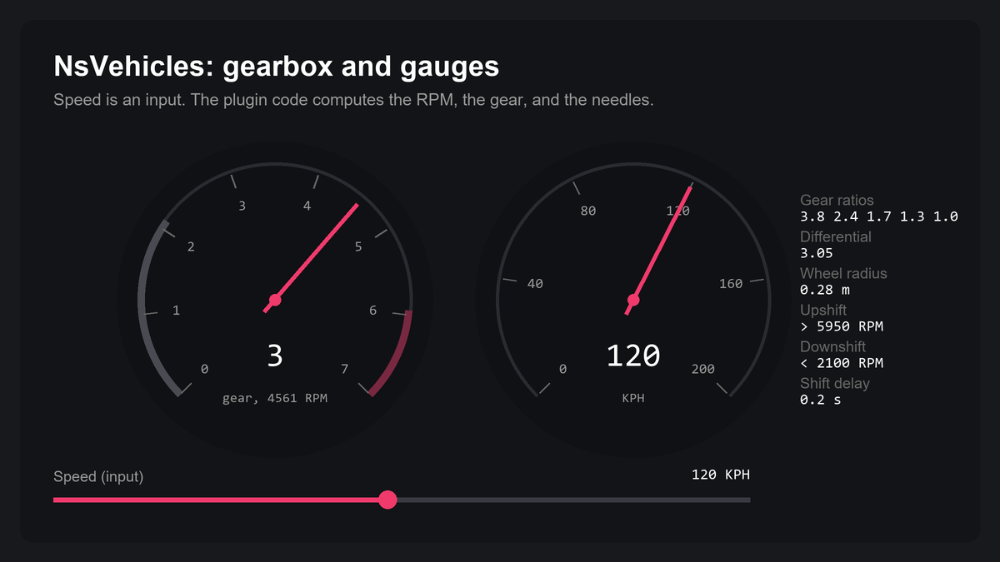

# NsVehicles User Guide

## Purpose

NsVehicles is a runtime plugin for physics vehicles: cars, karts, trucks, bikes, and hover vehicles. One physics body moves the vehicle. Suspension components trace the ground and push the body up. Module components on the vehicle add the drive, brake, steering, and other forces. You tune all of them in the Details panel, or call them from Blueprint and C++.

NsVehicles is not a full tire model, and it is not a Chaos Vehicles replacement. The wheels are traces, not colliders. The drive force acts on the body, not on each wheel. There is no clutch.

[](Showcase/Gearbox.html)

## Setup

1. Copy the `NsVehicles` folder into the `Plugins` folder of your project.
2. For C++, add `"NsVehicle"` and `"AsyncTickPhysics"` to `PublicDependencyModuleNames` in the `Build.cs` file of your game module. `ANsVehicle` derives from `AAsyncTickPawn`, which is in `AsyncTickPhysics`.
3. Generate the project files and build the project.
4. In **Edit > Plugins**, enable **NsVehicle**. Restart the editor.
5. Recommended: enable **Project Settings > Physics > Tick Physics Async**. The vehicle step then runs on the physics thread.

The plugin runs on Win64, Mac, Linux, Android, and iOS.

## Quick Start

### Blueprint

1. Make a Blueprint class with `NsVehicle` as the parent.
2. Add a Static Mesh component as the root. Give it a mesh with simple collision.
3. On the root, enable **Simulate Physics**.
4. Add four `NsVehicleSuspensionComponent` components under the root. Put each one above a wheel position.
5. On each suspension component, set **Wheel Mesh**.
6. On the two front suspension components, enable **Is Steering Wheel**.
7. In the input events, call `Get Controls`, then `Set Throttle Input`, `Set Brake Input`, and `Set Steering Input`.
8. Place the vehicle in a level, possess it, and press Play.

The vehicle gets all modules automatically. The default Engine module uses the arcade powertrain, so the vehicle drives with no other setup.

### C++

```cpp
#include "Modules/Control/NsVehicleControlsComponent.h"
#include "Vehicle/NsVehicle.h"

void AMyPlayerController::DriveForward(ANsVehicle* Vehicle, const float Input)
{
    Vehicle->GetControls()->SetThrottleInput(Input);
}
```

## Common Tasks

### Find a setting

Each system is a module component on the vehicle. Select the module in the Components panel to see its settings. In Blueprint or C++, call the module getter on the vehicle, for example `Get Engine`, `Get Brakes`, or `Get Steering`.

| Module | Getter | What it does |
|---|---|---|
| Controls | `Get Controls` | Holds the driver input and sends it to the server |
| Engine | `Get Engine` | Makes the torque and the RPM. Selects arcade or standard |
| Transmission | `Get Transmission` | Owns the gears, the differential, and the automatic gearbox |
| Drivetrain | `Get Drivetrain` | Removes power when the driven wheels slip |
| Brakes | `Get Brakes` | Owns the brakes, the reverse drive, and the handbrake |
| Steering | `Get Steering` | Limits the steering by speed and turns the steering wheels |
| BodyDynamics | `Get Body Dynamics` | Adds the body pitch and the bike lean |
| Aerodynamics | `Get Aerodynamics` | Adds the air drag in the standard powertrain |
| AirControl | `Get Air Control` | Turns the vehicle in the air |
| AntiGravity | `Get Anti Gravity` | Pulls the vehicle to the surface under it |
| IdleLock | `Get Idle Lock` | Holds the vehicle in place when it stops. The parked hold stops the physics of a vehicle that nobody drives |
| SelfRight | `Get Self Right` | Finds an overturned vehicle, and rolls it back with the steering |
| Network | `Get Network` | Replicates the vehicle state |
| Animation | `Get Animation` | Spins the wheels for the take recorder |

### Make a wheel mesh

1. Put the origin of the wheel mesh at the wheel center.
2. Put the axle on the Y axis. The wheel spins on its pitch axis.
3. Give the mesh simple collision if you want to detach the wheel.

The suspension uses half the mesh height as the wheel radius. With no wheel mesh, it uses **Radius** (33 cm).

### Change a wheel at run time

1. Call `SetWheelScale` for a bigger or a smaller wheel. The scaled radius sets the ride height, the trace length, and the wheel spin, so a big wheel lifts the vehicle.
2. Call `SetFrictionCoefficient` and `SetMaxLateralForceScalar` to change the grip of a driven wheel.

`GetScaledWheelRadius` returns the radius with the scale. `GetWheelRadius` returns the radius of the mesh with no scale.

### Show the wheels in the editor

1. Add a Static Mesh component under each suspension component. Set the wheel mesh on it.
2. On the suspension component, enable **Inherit Mesh From Component**.

The suspension uses its first child as the wheel mesh. Keep the wheel mesh as the first child, and attach other components to the root.

### Use the standard powertrain

1. On the Engine module, set **Powertrain Type** to Standard.
2. On the Transmission module, fill **Gear Ratios** with one ratio for each gear.
3. Set **Differential Ratio** and **Wheel Radius**. **Wheel Radius** is in meters.
4. Optional: set **Torque Implementation** to Curve, and set **Engine Torque Curve**.

The automatic gearbox shifts from the RPM. To shift from the speed, enable **Use Speed Based Shifting** and fill **Speed Shifting Ratios**. To shift by hand, disable **Automatic** and call `Upshift` and `Downshift`.

### Set up the driven wheels

1. On the Engine module, set **Powertrain Type** to Standard. The slip power loss works only in the standard powertrain.
2. On the Drivetrain module, enable **Use Drivetrain**.
3. On each suspension component, enable **Use With Drivetrain**.
4. On each driven wheel, enable **Driven Wheel**.
5. On each driven wheel, set **Torque Received**. For RWD, use 0.5 on each rear wheel.

A driven wheel slips when its torque is above the traction limit. Then it loses grip and spins faster. With **Use Drivetrain** on, the vehicle is airborne when no driven wheel touches the ground. **In Air Wheel Count** then has no effect.

### Detach a wheel

1. Give the wheel mesh simple collision.
2. Call `Detach Wheel` on the suspension component, after Begin Play. **Impulse** is a velocity change in cm/s.

```cpp
FrontLeftWheel->DetachWheel(FVector(0.f, -600.f, 400.f));
```

The wheel mesh becomes a free physics body with the velocity of the vehicle at that point. The suspension stops all its forces. The vehicle ignores detached wheels when it counts airborne wheels.

### Attach a detached wheel again

1. Call `Reattach Wheel` on the same suspension component.

The wheel mesh stops its physics, turns off its collision, and goes back under the suspension component. The suspension forces start again.

```cpp
FrontLeftWheel->ReattachWheel();
```

### Set up the handbrake

1. On the Brakes module, set **Handbrake Strength**.
2. On each suspension component that the handbrake holds, enable **Handbrake Wheel**.
3. Set **Handbrake Wheel Type** to Front or Rear.
4. Call `Get Controls`, then `Apply Handbrake Input`.

The handbrake wheels stop their spin while the handbrake is on. The handbrake does not change the grip. For a drift, set **Lateral Force Scalar** lower on the rear wheels while the handbrake is on.

### Make a bike lean in turns

1. On the Body Dynamics module, enable **Use Steer Lean**.
2. In Begin Play, call `Get Body Dynamics`, then `Initialize Lean Steer` with one suspension component. A rear wheel gives the best result.
3. Tune **Steer Lean Coefficient** and **Steer Lean Min Speed**.

### Drive on walls with anti gravity

1. Add a Scene component to the vehicle.
2. On the Anti Gravity module, enable **Anti Gravity Enabled**.
3. In Begin Play, call `Get Anti Gravity`, then `Initialize Anti Gravity`. Pass the Scene component and the root static mesh.
4. Tune **Anti Gravity Z Strength** first. Values from 1 to 2 work well.

The system stays on for **Anti Gravity Off Contact Threshold** seconds after the vehicle leaves the ground. Call `Override Anti Gravity State` with true to keep it on.

### Animate the interior

1. Add one of these components under the vehicle.
2. Set its mesh.

The vehicle sets the rotation on one axis every frame. The other axes keep their values from Begin Play.

| Component | Value | Default input range | Default angle range |
|---|---|---|---|
| `NsVehicleTachometerComponent` | Engine RPM | 0 to 7000 | 0 to 270, roll |
| `NsVehicleSpeedometerComponent` | Speed in KPH | 0 to 200 | 0 to 270, roll |
| `NsVehicleSteeringWheelComponent` | Steering input | -1 to 1 | -450 to 450, roll |
| `NsVehicleThrottlePedalComponent` | Throttle input | 0 to 1 | 0 to 20, pitch |
| `NsVehicleBrakePedalComponent` | Brake input | 0 to 1 | 0 to 20, pitch |
| `NsVehicleHandbrakeLeverComponent` | Handbrake input | 0 to 1 | 0 to 30, pitch |

Each one has **Input Range**, **Output Range**, **Rotation Axis**, **Use Smoothing**, **Smoothing Speed**, and **Invert**.

### Move a part, for example a forklift arm

1. Add an **NsVehicle Articulated Component** under the vehicle.
2. Set **Axis**, **Min**, **Max**, and **Movement Speed**.
3. Call `Set Input`. A positive value moves to Max. A negative value moves to Min.

### Follow a spline with AI

1. Add an `NsVehicleAI` component to the vehicle.
2. Call `Set Target Spline` with a spline component.
3. In Event Tick, call `Update` with the frame time.
4. Send **Out Steering** to `Set Steering Input`.

Tune **Kp** first, then **Kd** and **Kd2**. Use **Ki** to remove a constant offset. Call `Refresh` when you change the spline.

### Drive along a spline with AI

The drive mode of `NsVehicleAI` sets the throttle, the brake, and the steering itself. You do not call `Update`.

1. Add an `NsVehicleAI` component to the vehicle.
2. Call `Start Drive` with a spline component. The vehicle drives to the end of the spline.
3. Bind **On Drive Arrived** and **On Drive Stuck**. Call `Stop Drive` to stop early.

The drive mode steers to a point **Look Ahead Distance** ahead on the spline. After a stall it drives backward for **Reverse Seconds**, then tries again. After **Max Stall Retries** stalls with no progress, it stops and broadcasts **On Drive Stuck**. A player input in the same frame overrides it, so do not drive while the drive mode runs.

### Drive to a point with A* (Drive To)

`StartDriveTo` of `NsVehicleAI` plans a way to a goal with A* for a reach profile, then drives it with no spline. The plan and the drive are runtime code, so a packaged game can use them too.

1. Add an `NsVehicleAI` component to the vehicle.
2. Call `Start Drive To` with the goal and a **NsVehicle Reach Profile**. It returns false when there is no way.
3. Bind **On Drive Arrived** and **On Drive Stuck**. Call `Stop Drive` to stop early.

The A* plan tests each step with a box of the profile size plus **Clearance** on each side, on the collision channel and the responses of the vehicle body. A fence, a prop, or a wall that stops the vehicle also stops the plan. The plan ignores the ground, pawns (they move), and triggers with no physics collision. Each step also tests the ground at its middle, so a short steep bump between two grid points stops the plan. A prop with no simple collision is invisible to the plan and to the vehicle, so give every prop simple collision. The plan stays away from drops and water when it can (**Edge Cost**), and from steep ground (**Slope Cost**).

With **Min Turn Radius** on the profile, the plan turns at most 45 degrees in one grid step. When one grid step is shorter than the arc of a 45 degree turn at that radius, it also makes no two turns in a row. So the plan gives no tight zigzag, for example switchbacks on a steep bank, that the vehicle cannot follow. **Turn Cost** makes each turn cost more, for a way with fewer turns.

The plan smooths the grid way: a straight line replaces grid points when the line passes the same tests. The driver steers to a point ahead on the way. That point moves farther ahead with the speed, so a fast vehicle does not weave. The driver holds **Max Drive Speed** on a straight way and slows to **Corner Speed** before a turn and at the goal. It slows to **Descent Speed** before a steep way down, so it can still turn at the foot of a bank. The plan itself does not avoid steep ways down, so Drive To still finds the drops and banks that a player can use. After a stall it drives backward, marks the stall place as blocked, and plans again from where it is. After a stall on a slope, the next plans use less of the slope limit, because the vehicle could not climb what the plan allowed. The next drive starts with the full margin again. After **Max Replans** new plans it gives up. `Get Last Stuck Cause` tells why: "blocked by" an actor, "cannot climb", or "no way left".

From C++ or Python, call `UNsVehiclePathfinder::FindPath` to get the ground points of a way without a drive. Call `UNsVehiclePathfinder::SmoothPath` on the result for a way with fewer turns.

When the plan finds no way where you expect one, call `UNsVehiclePathfinder::DescribeStep` with two points about one grid step apart. It returns why the vehicle cannot drive that step, for example "too steep", "steep bump at the middle", or "blocked by" an actor, or an empty string when the step passes.

### Drive to a point in a play test (drive-to tool)

The editor command drives the player vehicle with Drive To. Use it to play test a route with a wheel setup, without driving by hand.

1. Set **Drive Profile** in Project Settings, NsVehicle Reach, or pass a profile in the command.
2. Start Play In Editor.
3. In the console, run `NsVehicle.DriveTo X Y Z [/Game/Path/Profile]`. The way draws on the ground, and the vehicle drives it.
4. Run `NsVehicle.DriveStop` to stop.

The vehicle is the pawn of the first player, or the vehicle nearest to that pawn. The command uses the path settings of Project Settings, NsVehicle Reach.

While the vehicle drives, the screen shows one line: the state, the progress, the number of plans, the speed, the pitch, and the stall count. The way is green where it is easy, yellow near the slope limit, and red over it. A new plan draws a new way.

### Test drives in the game (Vehicle AI tab)

With the NsCheats plugin in the project, the cheat window has a **Vehicle AI** tab. It works in Play In Editor and in development builds, not in Shipping.

1. Get in a vehicle and open the cheat window.
2. Pick the **Tire profile**.
3. Click **Drive to a picked point**, fly the free camera, and left click on the goal. Or set **Random radius**, **Landscape only**, and **Under water allowed**, and click **Drive to a random point**.
4. Watch the drive. **Drive status** shows the state, the plans, the stalls, the slope margin, the distance left, and the last lines of the drive log.
5. Click **Save the drive report** to write `Saved/QA/Drive_<time>.md`. Click **Go to the last stall** to look at the place where the drive gave up.
6. After a fix, click **Repeat from the same start**.

In Play In Editor, the **Hunt** section runs a hunt list from the tab.

From code, `UNsVehiclePathfinder::FindRandomPoint` gives a random point with an `FNsVehiclePointFilter`, and `UNsVehicleAI` gives `GetDriveLog`, `GetDriveStatus`, `SaveDriveReport`, and `RepeatLastDrive`.

### Hunt for weird spots (hunt tool)

The hunt drives the player vehicle to a list of places, one after the other, and writes a report. Use it to find the places that a player can reach and must not, and the places that a player cannot reach and must.

1. Make a **NsVehicle Hunt List** data asset. Set the profile, the targets, and the no-go zones. A no-go zone is a box that the vehicle must not enter.
2. Start Play In Editor.
3. In the console, run `NsVehicle.Hunt /Game/Path/HuntList`. Run `NsVehicle.HuntStop` to stop early.
4. Read the report in `Saved/NsVehicle/Hunt_<date>.md`. It lists each target with the result (arrived, stuck, no way, or timeout), the time, the new plans, the end place, and the cause. It also lists each entry into a no-go zone.

Each drive starts where the last one ended. **Target Time Limit** stops a drive that takes too long.

### Ignore some surfaces

1. In **Project Settings > Collision**, add a trace channel with the default response Block.
2. On each suspension component, set **Collision Channel** to the new channel.
3. On the objects that the wheels must ignore, set the response for the new channel to Ignore.

### Replicate the vehicle

1. On the Network module, set **Replication Method**.
2. For Data Only, use another system to correct the client position, for example **Replicate Movement** on the actor.

| Method | Server | Clients |
|---|---|---|
| Full | Simulates and sends the state | Copy the server velocities each physics step. They do not run the powertrain |
| Data Only | Simulates and sends the state | Copy the inputs, RPM, gear, and speed, then simulate |
| None | Simulates | Simulate. Nothing replicates |

With Full, **Use Server Fast Sync** also copies the server transform to the clients every **Server Fast Sync Latency** frames.

For many replicated vehicles, disable **Auto Wake Rigid Bodies** on the vehicle. Then call `RT Wake Rigid Bodies` often, for example from the input events.

### Send custom input to the server

1. Call `Get Controls`, then `Set Ext Replication Input` with an index from 0 to 5 and a value from -1 to 1.
2. On the server, read it with `Get Ext Replication Input`, for example in `Event Async Tick`.

The value goes from the client to the server only. Other clients do not get it.

### Check where a vehicle can drive (reach tool)

The editor module `NsVehicleEditor` paints the ground that a vehicle reaches from a start point. Use it to see which places a wheel setup opens, and to find a way that you did not plan, before a player finds it. It is editor only.

1. Make a **NsVehicle Reach Profile** data asset for each setup. Set the step height, the slope, the drop, the width, the height, and if it crosses water. For Drive To, also set **Min Turn Radius**: drive the vehicle in a circle at full steering and measure the radius at the center of the body.
2. In the editor console, run `NsVehicle.Reach X Y Z /Game/Path/Profile`. Green points show the reached ground.
3. Add a second profile to compare: `NsVehicle.Reach X Y Z /Game/Path/Base /Game/Path/Compare`. Orange points show the ground that only the second profile reaches.
4. With no editor open, run the commandlet: `-run=NsVehicleReach -Map=/Game/Maps/MyMap -Start=X,Y,Z -Profile=/Game/Path/Profile [-Compare=/Game/Path/Profile] -Out=C:/Path/Reach.csv [-Extent=20000]`. It loads the World Partition cells around the start and writes one point for each line.

A drop is one way: the vehicle goes down it, and the tool does not let it go back up. A box of the vehicle size moves from point to point, so a wall, a narrow gap, or a low roof stops it.

### Hold a parked vehicle still (parked hold)

The idle lock holds a stopped vehicle with a force. The suspensions still push the body, so a vehicle on a slope or a vehicle with a lost wheel can creep. The parked hold stops the physics of a vehicle that nobody drives.

1. On the IdleLock module, enable **Use Parked Hold**. In C++, call `GetIdleLock()->SetParkedHoldEnabled(true)` in the constructor.
2. A vehicle that no player controls waits **Parked Settle Time**. When it rests on the ground and is slower than **Parked Max Speed**, its physics stops.
3. A player who gets in gets the physics back at once.

- During a cutscene, call `Set Treat As Parked` with true, so the vehicle holds still while a player still controls it. Call it with false at the end.
- When something changes the stance, for example a lost or a new wheel, call `Release Parked Hold`. The vehicle settles on its wheels, then holds again.
- When your code stops the physics for a while, for example for a scripted turn, the settle time starts again when the physics comes back.

### Roll an overturned vehicle back (self right)

1. On the SelfRight module, enable **Use Self Right**. In C++, call `GetSelfRight()->SetSelfRightEnabled(true)` in the constructor.
2. Overturn the vehicle and steer. Each steering input adds a small hop and a roll to the side of the input, at most one time each **Roll Pulse Interval**.

`Is Overturned` compares the up of the vehicle with the ground normal under it, so a vehicle on a slope is not overturned. It works also with **Use Self Right** off, for example to show a "Flip" prompt. `Is Body On Ground` tells if the body rests on the ground.

### Scale the grip by the surface

1. On each suspension component, enable **Scale Grip By Surface**. In C++, call `SetSurfaceGripScaling(true, ReferenceFriction, MinScale, MaxScale)`.
2. Set **Grip Reference Friction** to the friction of your most common surface, so that surface keeps the grip of the wheel.
3. Give each surface a physical material with its own **Friction**.

The friction of the physical material under the wheel, over the reference friction, scales **Friction Coefficient** and **Max Lateral Force Scalar**. **Min Surface Grip Scale** and **Max Surface Grip Scale** limit the scale. A wheel in the air keeps the scale of its last surface. It works only with **Use With Drivetrain**, because only a drivetrain wheel uses these two values.

### Play a motor sound

1. Add an `NsVehicleMotorAudioComponent` to the vehicle, and set **Sound** to a looping sound.
2. Set **Idle Pitch**, **Full Speed Pitch**, **Idle Volume**, **Full Speed Volume**, and **Full Speed Kph**.

The sound fades in when a player gets in and fades out when the player gets out. Enable **Follow Engine RPM** to follow the RPM against the maximum RPM of the Engine module in place of the speed.

### Show the vehicle values on a board (cheat)

With the NsCheats plugin in the project, the **Vehicle AI** tab of the cheat window has the toggle **Show the vehicle values**. A board floats above the rear of the vehicle of the player and turns to the camera. It shows the speed, the gear, the RPM, the inputs, the holds, and for each wheel the compression, the contact, the physical material, and the grip scale. It works in Play In Editor and in development builds, not in Shipping.

To give the board the look of your game:

1. Make a Widget Blueprint with `NsVehicleValuesWidget` as the parent.
2. Add a text block named `ValuesText`. The widget writes the values into it each frame, so the Blueprint needs no graph.
3. In **Project Settings > Ns Vehicle Cheats**, set **Values Widget Class**, **Board Draw Size**, **Board Width Scale**, and **Board Offset**.

For your own layout, read `Get Values` in the Blueprint. It returns one `FNsVehicleValues` struct.

### Record with the take recorder

1. On the Animation module, enable **Enable Animation Mode**.
2. Record the vehicle with the take recorder.
3. Disable **Enable Animation Mode** after the recording.

In animation mode, the wheels spin from the actor movement, not from the physics. For playback, add `NsVehicleWheel` components to the root. Then call `Initialize Animation System` one time and `Simulate Internal Animation` every frame.

## Settings

Every value is the default in the code. Some settings show only when another setting enables them.

### Vehicle

| Setting | Default | Effect |
|---|---|---|
| In Air Wheel Count | 2 | Wheels off the ground that make the vehicle airborne. An airborne vehicle gets no drive force. No effect with **Use Drivetrain** |
| Auto Wake Rigid Bodies | true | Wakes the physics body every frame |

### Engine

| Setting | Default | Effect |
|---|---|---|
| Powertrain Type | Arcade | Arcade: torque that fades out near the top speed, no gearbox. Standard: RPM, gears, and drag |
| Engine Torque | 500 | Peak torque in Nm |
| Max Speed | 318 | Arcade top speed in KPH |
| Max RPM | 7000 | Standard maximum RPM |
| Rpm Limit Torque Floor | 0.06 | Drive force scale that stays at the RPM limit |
| RPM Multiplier | 1 | RPM scale. Other values can make the engine unstable |
| Torque Implementation | Constant | Constant torque, or torque from a curve |
| Engine Torque Curve | none | Torque multiplier curve. X is the RPM |
| Engine Brake Coefficient | 0.35 | Deceleration with no throttle |

### Transmission

| Setting | Default | Effect |
|---|---|---|
| Transmission Efficiency | 0.7 | Scales the acceleration. No effect on the top speed |
| Shift Delay | 0.2 | Shift time in seconds. The throttle is 0 during an upshift |
| Differential Ratio | 3.05 | Standard final drive ratio |
| Gear Ratios | empty | One ratio for each gear. Empty uses 3.5 |
| Wheel Radius | 0.28 | Drive wheel radius in meters |
| Automatic | true | Automatic gearbox |
| Use Speed Based Shifting | false | Shifts from the speed, not the RPM |
| Speed Shifting Ratios | empty | Downshift (X) and upshift (Y) speed in KPH for each gear |
| Upshift Ratio | 0.85 | RPM to Max RPM ratio for an upshift |
| Downshift Ratio | 0.3 | RPM to Max RPM ratio for a downshift |
| Lock Shift | false | Stops all shifts |

### Drivetrain

| Setting | Default | Effect |
|---|---|---|
| Use Drivetrain | false | Enables the wheel slip power loss |
| Effective Power | 1 | Part of the power that gets to the wheels |
| Slip Power Reduction | 1 | Power loss when the wheels slip |
| Slip Initiate Speed | 15 | How fast the slip starts |
| Slip Restore Speed | 0.5 | How fast the traction comes back |
| In Air Speed Up | 10 | How fast the RPM goes up in the air |
| In Air Slowdown Speed | 2 | How fast the RPM goes down in the air |

### Brakes

| Setting | Default | Effect |
|---|---|---|
| Brake Force | 15000 | Brake force in N. Also the reverse force |
| Use Brake As Reverse | true | The brake input drives backward in the standard powertrain. The arcade powertrain always does this |
| Max Speed In Reverse | 60 | Reverse top speed in KPH |
| Handbrake Strength | 7500 | Handbrake force in N |

### Steering

| Setting | Default | Effect |
|---|---|---|
| Drift Torque | 0 | Helper yaw torque that follows the steering |
| Steering Input Clamp | No Clamp | How the maximum steering changes with speed |
| Constant Steering Clamp | 1 | Maximum steering at all speeds |
| Linear Steering Input Clamp | all 0 | Speed range in KPH to maximum steering range |
| Curve Steering Input Clamp | none | Maximum steering as a curve of speed |
| Use Sensitivity Clamp | false | Steering response from a speed range |
| Steering Sensitivity | 5 | Steering response speed |
| Steering Sensitivity Clamp | all 0 | Speed range in KPH to response range |

### Body Dynamics

| Setting | Default | Effect |
|---|---|---|
| Dynamic Pitch Moment Multiplier | 0 | Pitch under acceleration |
| Dynamic Brake Moment Multiplier | 0 | Pitch under braking |
| Use Steer Lean | false | Bike lean in a turn |
| Steer Lean Coefficient | 4.85 | Lean force |
| Steer Lean Min Speed | 5 | Speed in KPH for full lean |
| Steer Lean Mapping | 0.9, 0.99 | Ground normal range for the lean strength |

### Aerodynamics, Air Control, Anti Gravity, Idle Lock, Self Right

| Module | Setting | Default | Effect |
|---|---|---|---|
| Aerodynamics | Coefficient Of Drag | 0.3 | Drag coefficient |
| Aerodynamics | Cross Section Area | 1.587 | Frontal area in m^2 |
| Aerodynamics | Air Density | 1.225 | Air density in kg/m^3 |
| Air Control | Pitch Strength | 2 | Air control torque on the pitch axis |
| Air Control | Yaw Strength | 2 | Air control torque on the yaw axis |
| Air Control | Roll Strength | 2 | Air control torque on the roll axis |
| Anti Gravity | Anti Gravity Enabled | false | Enables the system |
| Anti Gravity | Gravity Strength | 980 | Gravity in cm/s^2 |
| Anti Gravity | Anti Gravity Z Strength | 1.2 | Pull to the surface |
| Anti Gravity | Anti Gravity X Strength | 1.02 | Stops roll back on a slope |
| Anti Gravity | Anti Gravity Y Strength | 1.02 | Stops side slip on a slope |
| Anti Gravity | Anti Gravity Off Contact Threshold | 1 | Seconds the system stays on in the air |
| Anti Gravity | Added Mass | 0 | Extra mass in kg |
| Idle Lock | Use Idle Lock | true | Holds the stopped vehicle |
| Idle Lock | Idle Lock Time | 1.5 | Seconds before the hold |
| Idle Lock | Is Idle Locked | false | The hold state. Set it at runtime to control the hold |
| Idle Lock | Idle Lock Speed Threshold | 10 | Speed in KPH below which the timer starts |
| Idle Lock | Idle Lock Stiffness | 3000 | Hold force on slopes |
| Idle Lock | Use Parked Hold | false | Stops the physics of a vehicle that nobody drives, after it lands and settles |
| Idle Lock | Parked Settle Time | 1 | Seconds that a vehicle nobody drives settles before the hold test. A vehicle that fails the test waits one more settle time |
| Idle Lock | Parked Max Speed | 20 | Highest speed in cm/s at which the parked hold can start |
| Self Right | Use Self Right | false | The steering rolls an overturned vehicle back |
| Self Right | Overturned Up Dot | 0.65 | Highest alignment of the vehicle up with the ground normal that counts as overturned |
| Self Right | Roll Pulse Interval | 0.22 | Shortest time in seconds between two roll impulses |
| Self Right | Hop Velocity | 150 | Vertical velocity change of one hop in cm/s |
| Self Right | Roll Angular Impulse | 5 | Roll velocity change of one impulse at a full steering input |
| Self Right | Max Vertical Speed | 30 | Highest vertical speed in cm/s that allows an impulse |
| Self Right | Ground Reach | 3 | Distance in cm below the body bounds that still counts as ground |
| Self Right | Ground Channel | Visibility | Trace channel of the ground test |

### Network and Animation

| Module | Setting | Default | Effect |
|---|---|---|---|
| Network | Replication Method | None | Full, Data Only, or None |
| Network | Use Server Fast Sync | true | Clients copy the server transform at an interval. Full only |
| Network | Server Fast Sync Latency | 500 | Game frames between two syncs |
| Animation | Enable Animation Mode | false | Spins the wheels from the actor movement |
| Animation | Animation Global Wheel Speed Multiplier | 1 | Wheel spin scale in animation mode |
| Animation | Anim Delta Time | 0.0167 (1/60) | Fixed frame time for the animation |

### Suspension component

| Setting | Default | Effect |
|---|---|---|
| Stiffness | 22500 | Spring stiffness in N/m |
| Damping | 1250 | Spring damping |
| Extension Length | 50 | Maximum spring length in cm |
| Is Steering Wheel | false | The wheel gets the steering input |
| Collision Channel | WorldStatic | Trace channel |
| Allow Full Rotation | false | Keeps the suspension pitch and roll when it steers |
| Zero Force Component | false | Stops all forces of this suspension |
| Override Contact | false | Applies contact forces with no contact. Keep it off |
| Inherit Mesh From Component | false | Uses the first child static mesh as the wheel mesh |
| Wheel Mesh | none | The wheel mesh that the suspension makes in Begin Play |
| Hide Wheel Mesh | false | Hides the wheel mesh |
| Rotate Wheel | false | Turns the wheel mesh 180 degrees, usually on the left side |
| Mirror Wheel On Local Y | false | Mirrors the wheel mesh |
| Wheel Z Offset | 0 | Visual offset in cm. No effect on physics |
| Handbrake Wheel | false | The handbrake holds this wheel |
| Handbrake Wheel Type | Front | Handbrake axle of this wheel |
| Lateral Force Scalar | 2000 | Grip. Hidden with **Use With Drivetrain** |
| Max Lateral Force | 8500 | Maximum lateral force in N |
| Low Speed Lateral Force Scalar | 4000 | Grip at very low speed |
| Contact Force Offset Location | 0 | Moves the lateral force point. Controls the body roll |
| Wheel Angular Velocity Multiplier | 1 | Wheel spin scale |
| Burnout Rotation | 0 | Constant wheel spin |
| Resistance Force Coefficient | 0 | Force against the forward movement at the tire |
| Max Resistance Force | 5000 | Maximum resistance force in N |
| Max Steering Angle | 40 | Maximum steering angle in degrees |
| Steering Release Speed | 12 | How fast the wheel steers back to 0 |
| Hybrid Raycast | true | Sphere trace with a line trace fallback. Off uses a line trace only |
| Radius | 33 | Trace sphere radius in cm when there is no wheel mesh |
| Impact Normal Tolerance | 0.9 | Normal limit for the sphere trace |
| Impact Height Tolerance | 30 | Maximum contact height in cm for the sphere trace |
| Debug | false | Draws the trace |
| Use Idle Lock | true | Stops the wheel spin after a stop. Off with **Use With Drivetrain** |
| Idle Lock Time | 1.5 | Seconds before the wheel spin stops |
| Scale Grip By Surface | false | Scales the traction limit and the side grip of a drivetrain wheel by the friction of the physical material under it |
| Grip Reference Friction | 0.7 | Friction that keeps the grip as it is. 0.7 is the friction of the default physical material |
| Min Surface Grip Scale | 0.4 | Lowest grip scale |
| Max Surface Grip Scale | 1.5 | Highest grip scale |

With **Use With Drivetrain** on:

| Setting | Default | Effect |
|---|---|---|
| Use With Drivetrain | false | Uses this wheel with the drivetrain |
| Driven Wheel | false | The drivetrain sends torque to this wheel |
| Torque Received | 0.5 | Share of the drive torque, from 0 to 1 |
| Friction Coefficient | 1.5 | Traction limit. Higher values give less slip |
| Max Lateral Force Scalar | 3000 | Grip when the wheel does not slip |
| Slipping Lateral Force Scalar | 250 | Grip when the wheel slips |
| Slipping Angular Velocity | 4 | Spin scale when the wheel slips |
| Air Rotation Multiplier | 20 | Maximum wheel spin with throttle in the air |
| In Air Speed Up | 10 | How fast the wheel spins up in the air |
| In Air Slowdown Speed | 2 | How fast the wheel slows down in the air |

### Motor audio component

| Setting | Default | Effect |
|---|---|---|
| Idle Pitch | 0.7 | Pitch at rest |
| Full Speed Pitch | 1.6 | Pitch at the full speed |
| Idle Volume | 0.35 | Volume at rest |
| Full Speed Volume | 0.8 | Volume at the full speed |
| Full Speed Kph | 15 | Speed in KPH that gives the full speed pitch and volume |
| Follow Engine RPM | false | Follows the RPM against the maximum RPM in place of the speed |
| Fade Seconds | 0.3 | Fade time when a player gets in or out |

### Vehicle cheats (Project Settings > Ns Vehicle Cheats)

| Setting | Default | Effect |
|---|---|---|
| Values Widget Class | None | The widget of the values board. None uses a plain text board |
| Board Draw Size | 480 x 320 | Size of the board widget in pixels |
| Board Width Scale | 1 | Width of the board as a part of the width of the vehicle |
| Board Offset | 0, 0, 0 | Offset in cm from the top of the rear of the vehicle, in the space of the vehicle |

### Interior, articulated, AI, and wheel components

| Component | Setting | Default | Effect |
|---|---|---|---|
| Interior | Use Smoothing | false | Smooths the rotation |
| Interior | Smoothing Speed | 5 | How fast the smoothed rotation follows |
| Interior | Invert | false | Inverts the value before the mapping |
| Articulated | Axis | Z Location | Movement axis |
| Articulated | Clamped | true | Clamps the movement between Min and Max |
| Articulated | Min | 0 | Minimum movement |
| Articulated | Max | 100 | Maximum movement |
| Articulated | Movement Speed | 1 | Movement in each frame at 60 FPS and full input |
| Articulated | Use Smoothing | true | Smooths the movement |
| Articulated | Smoothing Speed | 10 | How fast the smoothed movement follows |
| NsVehicleAI | Kp | 0.3 | Proportional gain |
| NsVehicleAI | Kd | 0.2 | Derivative gain |
| NsVehicleAI | Kd2 | 0.2 | Second derivative gain |
| NsVehicleAI | Ki | 0.5 | Integral gain |
| NsVehicleAI | Max Integral | 20 | Maximum integral error |
| NsVehicleAI | Output Max | 1 | Maximum steering output |
| NsVehicleAI | Min Delta Time | 0.0001 | Minimum time step for the I and D terms |
| NsVehicleAI | Draw Debug | false | Draws the target point and the error |
| NsVehicleAI | Drive Throttle | 1 | Throttle input of the drive mode |
| NsVehicleAI | Look Ahead Distance | 150 cm | Distance ahead on the spline of the steering point |
| NsVehicleAI | Full Steer Angle | 30 deg | Angle to the steering point that gives the full steering input |
| NsVehicleAI | Arrive Distance | 120 cm | Distance to the end of the spline at which the drive mode stops |
| NsVehicleAI | Stall Speed | 5 cm/s | Speed under which the vehicle counts as stalled |
| NsVehicleAI | Stall Seconds | 2.5 s | Time under the stall speed before the drive mode backs off |
| NsVehicleAI | Reverse Seconds | 1.5 s | Time of the drive backward after a stall |
| NsVehicleAI | Max Stall Retries | 4 | Stalls with no progress before On Drive Stuck |
| NsVehicleAI | No Progress Seconds | 6 s | Time with no progress along the spline after which a slow vehicle backs off, for example when it shakes against a wall |
| NsVehicleAI | No Progress Speed | 30 cm/s | Speed under which no progress counts as a stall. A faster vehicle, for example one that drives back to the spline from the side, does not back off |
| NsVehicleAI | Progress Distance | 100 cm | Gain along the spline that resets the stall count |
| NsVehicleAI | Path Query | See below | The grid, the traces, and the costs of the A* plan of Drive To |
| NsVehicleAI | Waypoint Look Ahead | 60 cm | Distance ahead on the way of the steering point of Drive To, at rest |
| NsVehicleAI | Look Ahead Time | 0.35 s | Time of travel that adds to the steering distance. A fast vehicle steers to a point farther ahead |
| NsVehicleAI | Steer Damping | 0.12 s | Time of the yaw rate that Drive To takes from the heading error. A higher value turns in more calmly |
| NsVehicleAI | Steer Rate | 3 | Largest change of the steering input in one second |
| NsVehicleAI | Max Drive Speed | 300 cm/s | Speed of Drive To on a straight way |
| NsVehicleAI | Corner Speed | 100 cm/s | Speed of Drive To in a sharp turn and at the goal |
| NsVehicleAI | Corner Look Ahead | 250 cm | Distance ahead on the way in which Drive To looks for a turn |
| NsVehicleAI | Sharp Turn Angle | 60 deg | Turn angle ahead at which the target speed is the corner speed |
| NsVehicleAI | Descent Speed | 80 cm/s | Target speed on a steep way down |
| NsVehicleAI | Steep Descent Angle | 30 deg | Slope down ahead at which the target speed is the descent speed |
| NsVehicleAI | Speed Band | 120 cm/s | Speed error that gives the full throttle or the full brake |
| NsVehicleAI | Cruise Throttle | 0.3 | Throttle at the target speed |
| NsVehicleAI | Max Smooth Skip | 12 | Grid points that one straight part of the smoothed way can replace |
| NsVehicleAI | Waypoint Arrive Distance | 40 cm | Distance to the goal at which Drive To stops |
| NsVehicleAI | Max Replans | 6 | New plans after stalls before Drive To gives up |
| NsVehicleAI | Slope Stall Pitch | 10 deg | Pitch above which a stall counts as a stall on a slope |
| NsVehicleAI | Slope Margin Step | 0.05 | Part of the slope limit that each stall on a slope takes from the next plans of the same drive |
| NsVehicleAI | Min Slope Margin | 0.7 | Lowest slope margin that stalls on slopes can give |

The **Path Query** of Drive To:

| Setting | Default | Effect |
|---|---|---|
| Grid Spacing | 50 cm | The distance between two tested points |
| Max Cells | 400000 | The plan stops at this number of points |
| Trace Height | 300 cm | The height above the ground where the ground trace starts |
| Trace Channel | WorldStatic | The channel of the ground trace |
| Water Class Name Filter | WaterBody | An actor whose class name holds this text is water |
| Slope Margin | 0.9 | The part of the slope limit of the profile that the plan uses |
| Slope Cost | 2 | The extra cost of a climb |
| Edge Cost | 4 | The extra cost of a step next to a drop, a void, water, or a bank steeper than the slope limit |
| Blocked Radius | 60 cm | The radius around each blocked point that the plan does not cross |
| Clearance | 10 cm | The free space on each side of the vehicle that a step needs |
| Wall Angle | 50 deg | A hit surface steeper than this angle is a wall. A flatter surface is ground |
| Turn Cost | 0 cm | The extra cost of each turn of 45 degrees. Higher values give a way with fewer turns |
| Heuristic Weight | 1 | The weight of the distance to the goal. 1 gives the cheapest way. A higher value can find a way sooner, but the way can be longer, and near a goal in rough ground it can search more |

The **Min Turn Radius** of the reach profile (default 0 cm) is the tightest turn of the vehicle. At 0 the plan allows any turn, as before. The reach tool ignores it.

| NsVehicleStaticWheel | Enabled | true | Spins the wheel |
| NsVehicleStaticWheel | Invert Direction | false | Inverts the spin |
| NsVehicleStaticWheel | Rotation Multiplier | 1 | Spin scale |
| NsVehicleWheel | Rotate Wheel | false | Inverts the spin in animation mode |

### Reach tool

Project Settings, NsVehicle Reach:

| Setting | Default | Effect |
|---|---|---|
| Grid Spacing | 50 cm | The distance between two tested points. A smaller value finds narrower ways and takes longer |
| Max Cells | 400000 | The run stops at this number of points |
| Trace Height | 300 cm | The height above the ground where the trace for the next point starts |
| Trace Channel | WorldStatic | The channel of the ground and the walls |
| Water Class Name Filter | WaterBody | An actor whose class name holds this text is water |
| Reached Color, Compare Only Color, Point Size, Draw Seconds | Green, orange, 6, 120 s | The drawing in the editor |
| Path Slope Cost | 2 | The extra cost of a climb in the path search. At 0 the way is the shortest. Higher values keep the way on gentle ground |
| Path Slope Margin | 0.9 | The part of the slope limit of the profile that the path search uses. A vehicle stalls at its exact limit on rough ground |
| Path Clearance | 10 cm | The free space on each side of the vehicle that the path search needs. The reach tool uses 0 |
| Path Edge Cost | 4 | The extra cost of a step next to a drop, a void, or water in the path search. At 0 the way can follow a cliff edge |
| Drive Profile | None | The profile of `NsVehicle.DriveTo` when the command names none |

The hunt list:

| Setting | Default | Effect |
|---|---|---|
| Profile | None | The wheel setup of the hunt |
| Targets | Empty | The places to drive to, in this order |
| No Go Zones | Empty | The boxes that the vehicle must not enter |
| Target Time Limit | 300 s | The time limit of one drive |

## Debug

- On a suspension component, enable **Debug**. The sphere trace draws as a capsule. Its color goes from green to red with the compression. A line trace draws in orange. The impact point draws in yellow.
- On an `NsVehicleAI` component, enable **Draw Debug**. A blue sphere marks the vehicle, a red sphere marks the closest spline point, and a green line joins them.
- The log categories are `LogNsVehicleAI`, `LogNsVehiclePath`, `LogNsVehicleCheats`, and `LogNsVehicleEditor` (editor). The vehicle and wheel components still log to `LogTemp`: search the Output Log for `NsVehicle`.
- `LogNsVehicleCheats` writes the result of each vehicle cheat, and an error when the values board has a vehicle with no primitive root.
- To show the state on screen, read `Get Speed KPH`, `Is In Air`, `Get RPM`, `Get Current Gear`, `Is Slipping`, `Is Idle Locked`, `Is Parked Held`, or `Is Overturned`.
- With NsCheats, turn on **Show the vehicle values** on the **Vehicle AI** tab. A board above the rear of the vehicle shows the live values. See [Show the vehicle values on a board](#show-the-vehicle-values-on-a-board-cheat).

The editor console command `NsVehicle.Reach` runs the reach tool. `NsVehicle.DriveTo` and `NsVehicle.DriveStop` run the drive-to tool, and `NsVehicle.Hunt` and `NsVehicle.HuntStop` run the hunt tool, in Play In Editor. The runtime has no console commands and no console variables. The editor tools log to `LogNsVehicleEditor`. The A* plan logs to `LogNsVehiclePath`: no way and the cell limit as Warning. The drive mode of `NsVehicleAI` logs to `LogNsVehicleAI`: an arrival as Display, and a stuck vehicle as Warning. With **Draw Debug**, the drive mode draws a yellow line to its steering point and shows its state on screen. The on-screen state is not in Shipping builds.

## Troubleshooting

| Problem | Cause | Fix |
|---|---|---|
| The vehicle does not move. The log shows "has no primitive root component" | The root is not a primitive component | Make a static mesh with collision the root |
| The vehicle does not move, with no log message | The root does not simulate physics | Enable **Simulate Physics** on the root |
| The standard vehicle applies no force. The log shows "uses a torque curve but has no curve asset" | **Torque Implementation** is Curve and **Engine Torque Curve** is empty | Set a curve, or set **Torque Implementation** to Constant |
| The vehicle gets no drive force with **Use Drivetrain** on | No wheel has **Driven Wheel** on, so the vehicle is airborne | Enable **Use With Drivetrain** and **Driven Wheel** on the driven wheels |
| The vehicle does not steer | **Steering Input Clamp** is Linear, and **Linear Steering Input Clamp** is all 0 | Set both ranges, or use another clamp |
| The detached wheel does not fall. The log shows "cannot simulate the detached wheel" | The wheel mesh has no simple collision | Add simple collision to the wheel mesh. Call `Reattach Wheel` |
| The log shows "has no wheel mesh component to detach" | `Detach Wheel` ran before Begin Play | Call it after Begin Play |
| The log shows "ExtensionLength ... shorter than wheel collision radius" | The wheel can sink into the ground | Increase **Extension Length**, or move the suspension up |
| The log shows "Stiffness" or "Damping" with a value of 0 | The wheel cannot hold the vehicle, or it bounces | Set a value above 0 |
| The log shows "physics wheel radius ... visual wheel radius" | `Set Physics Wheel Radius` got a radius far from the wheel mesh | Use the wheel mesh radius in meters |
| Lean steer or anti gravity has no effect | The initialize call is missing, or it got an empty value | Call `Initialize Lean Steer` or `Initialize Anti Gravity` in Begin Play |
| The log shows "got custom input index" | The index is outside 0 to 5 | Use an index from 0 to 5 |
| A client disconnects after an input call | A value outside -1 to 1 fails the server validation | Clamp the input values |
| The game crashes in the AI `Update` | `Update` ran with no target spline | Call `Set Target Spline` first |
| The vehicle jumps after a stop | **Idle Lock Stiffness** is too high | Lower **Idle Lock Stiffness**, or disable **Use Idle Lock** |

## Limits

- Keep the actor scale at 1. The physics step ignores the actor scale, so a scaled vehicle puts the wheels in the wrong place.
- Wheel detach and reattach are local. They do not replicate.
- The vehicle finds its suspension, interior, and articulated components in Begin Play. It does not update components that you add later.
- The parked hold and the self right are local. They change the physics of the body on this machine only. Use them in a single player game, or on the machine that simulates the vehicle.
- The parked hold counts a vehicle as driven only when a player controls it. A vehicle that an AI controller drives holds still after the settle time.
- The self right reads the steering input of the Controls module, so an AI that steers an overturned vehicle also rolls it.
- The values board stays on the vehicle where it started. To move it to another vehicle, turn the toggle off and on.
- `Event Async Tick` runs two times in each physics step. On a client in Full mode, it runs one time.
- The custom inputs go to the server only.
- The modules are fixed. You cannot remove a module or replace it with a subclass.
- There is no clutch simulation.
- The A* plan tests the same grid as the reach tool. A way that is narrower than the grid spacing can be missed.
- The A* plan runs in one frame. A long way on a fine grid can take some seconds. Plan once, not each tick.
- The turn limit starts with no heading. The first step of a plan can go in any direction, so after a stall the first turn can be tighter than the vehicle turns. The driver drives backward before it plans again, which usually gives the room.
- The plan allows any slope down when each step drops less than **Max Drop Height**. The driver slows before a steep way down, but on a very steep bank gravity can still make the vehicle fast before the foot.
- The plan knows the slope limit of the profile, not the real grip on each surface. A wet or loose surface can stop the vehicle on a way that the plan accepts. The driver then plans again.
- The hunt list and the hunt tool are editor only.
- The Vehicle AI tab drives the vehicle that the first player drives, or the vehicle nearest to the pawn of that player.
- The tab finds the reach profiles with the asset registry. A profile saved before the profile class moved to the runtime module loads, but the search does not find it until you save it one time.
- The grid aligns to the world at multiples of the grid spacing, so one place gives one way. A passage that is near the width of the vehicle plus the clearance can still be open on one side of a grid line and closed on the other.
- The plan reads the simple collision of the ground and the props, as the wheels do. A prop with collision of the whole mesh, for example one convex hull around a tree, is a solid block for the plan and for the vehicle. Give a tree a trunk capsule.
- In World Partition, the plan sees only the loaded cells. A plan in the editor world depends on the cells that the editor has loaded.

### Keep a parked vehicle on a slope

Set `RestFrictionSlopeDegrees` on the brake module, and turn off the idle lock. With no input and at a low speed, the module applies static friction. The vehicle stays on a slope up to this angle. On a steeper slope the force reaches its limit and the vehicle rolls, as a real one does.
